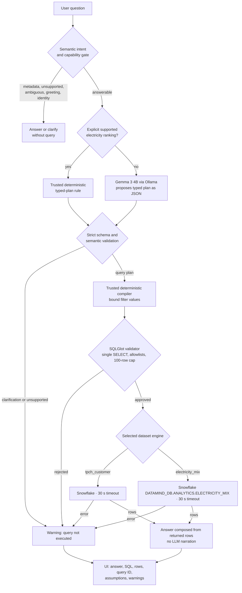

# Problem Statement

**The challenge.** Organizations hold large amounts of information in databases, spreadsheets, documents and other sources. Getting a useful answer often takes technical skills, specialised queries or hours of manual searching, so the people who understand the questions best are often the least able to reach the data.

**Your mission.** Create an AI-powered data experience that lets people ask questions in everyday language and get useful answers grounded in the available data, with enough explanation that users trust the response reflects the information actually examined.

**Keep in mind.** The goal is not fluent text. The system must meaningfully work with data (retrieve, query, analyse) and make its answers understandable and trustworthy. Think broadly about data types, industries and users: business intelligence, operations, research, education, finance and decision-making are all fair game. Unlike a chatbot that produces plausible text, a data agent computes answers from the real data, shows the query, rows or sources, flags gaps, and changes its answer when the data changes.

---

[README.md](https://github.com/user-attachments/files/33623777/README.md)<div align="center">
<div align="center">

# 🐉 DataMind: Talk to Your Data

### Ask questions in plain English. Get answers computed from the selected data source, with query evidence.

**ZeroDay OSS Hacktoberfest 2026 · IIIT Dharwad · Track PS1**

[](LICENSE)


[Overview](#-overview) · [Datasets](#-supported-datasets) · [Sponsored technologies](#-use-of-sponsored-technologies) · [Architecture](#-architecture) · [Quick start](#-quick-start) · [Safety](#-safety-model) · [Testing](#-testing-and-evaluation) · [Limitations](#-limitations)

</div>

---

## 📌 Overview

Organizations hold large amounts of information in databases, but getting a useful answer usually takes SQL skills, specialised queries or hours of manual searching. The people who understand the questions best are often the least able to reach the data.

**DataMind** is a natural-language interface to two explicitly registered datasets:

1. You ask a question in everyday language.
2. The semantic intent gate checks the selected dataset's capabilities. For answerable questions, **Gemma 3 4B**, running locally through **Ollama**, usually proposes a typed query plan. A narrow deterministic rule handles explicit electricity country rankings without calling Gemma; the plan source is shown in response evidence.
3. Trusted Python validates the plan for the selected catalog, compiles deterministic SQL, and binds filter values; the **SQLGlot validator** checks the compiled SQL.
4. `tpch_customer` routes to Snowflake TPC-H CUSTOMER; `electricity_mix` routes to `DATAMIND_DB.ANALYTICS.ELECTRICITY_MIX`. TPC-H remains the default when no dataset is selected.
5. Successful query answers are composed **directly from returned rows** and include a Snowflake query ID when Snowflake supplies one.

> **Design principle: Gemma proposes a plan, trusted Python validates and compiles it, the SQL validator enforces policy, and Snowflake computes the result.**
> Gemma does not return executable SQL or narrate results. Its plan is constrained to registered fields and operations before a query can execute.

### Response evidence

| Output | Meaning |
|---|---|
| `answer`, `outcome` | Result, clarification, metadata response, rejection, or failure |
| `dataset_id`, `intent_classification`, `capability_match` | Selected dataset and pre-planning intent/capability evidence |
| `query_plan`, `plan_validation`, `plan_source` | Typed plan and its validation, when planning ran |
| `sql`, `sql_parameters`, `validation` | Compiled parameterized SQL and SQL-policy evidence, when compilation ran |
| `columns`, `rows`, `row_count`, `query_id` | Returned results and Snowflake query ID, when execution returned them |
| `execution`, `verification` | Execution status and deterministic result-consistency checks; neither asserts semantic correctness |
| `assumptions`, `warnings`, `clarification`, `missing_concepts` | Planning assumptions, notices, requested clarification, or unsupported requirements |

### Example questions

```text
Show five customers with the highest account balances.
Count customers by market segment.
Who are the best customers?      →  asks a clarifying question before querying
How did renewable electricity generation change in India from 2023 to 2025?
Rank countries by renewable electricity generation for 2025, highest first.
```

Electricity questions are limited to combined renewable generation in terawatt-hours. The bundled view has no individual solar/wind breakdown, renewable share, or per-capita measure.

### Supported datasets

| Dataset ID | Snowflake table | Contents and supported scope |
|---|---|---|
| `tpch_customer` (default) | `SNOWFLAKE_SAMPLE_DATA.TPCH_SF1.CUSTOMER` | Snowflake's TPC-H sample customer records. Registered fields: `C_CUSTKEY`, `C_NAME`, `C_ACCTBAL` (USD), and `C_MKTSEGMENT`. It contains customer/account data, not sales, products, orders, transaction dates, or revenue. |
| `electricity_mix` | `DATAMIND_DB.ANALYTICS.ELECTRICITY_MIX` | Our World in Data's annual combined renewable electricity generation for ISO-coded countries and territories, 2000–2025. Fields: `ENTITY`, `CODE`, `YEAR`, and `RENEWABLES_TWH` (TWh). The bundled snapshot has 5,387 rows across 214 entities. |

Both datasets execute through Snowflake. The project does not create or refresh the electricity table automatically; `data/electricity_mix.csv` is retained as the reproducible source subset, not used as a query fallback. Electricity data is combined renewable generation, not a share, per-capita value, total generation, or individual fuel series. Missing country-year observations are not treated as zero. For the [OWID source](https://ourworldindata.org/grapher/electricity-mix), column mapping, loading notes, and attribution, see [`DATASETS.md`](DATASETS.md).

---

## ✅ Requirement checklist

### Core requirements

| ID | Requirement | How DataMind meets it |
|---|---|---|
| M1 | Everyday-language questions | Intent gate and Gemma 3 4B interpret questions; a deterministic rule handles a narrow electricity-ranking case |
| M2 | Answers from real querying at question time | Successful data queries execute against the selected Snowflake table |
| M3 | Grounded answers, no unsupported model claims | Answer text is composed from returned rows; the LLM does not narrate results |
| M4 | Plain-language explanation of how the answer was obtained | Answer, assumptions and warnings returned with every response |
| M5 | Inspectable evidence | Selected dataset and, when a query runs, SQL, returned rows and Snowflake query ID |
| M6 | Handling of ambiguity, empty results, unsupported requests | See [Behaviour on hard cases](#-behaviour-on-hard-cases) |
| M7 | Meaningful Snowflake and Gemma integration | See [Use of Sponsored Technologies](#-use-of-sponsored-technologies) |
| M8 | Working, reproducible, open source | This repository, MIT licensed, with setup and tests |

### Compliance gates

| Gate | Requirement | Status |
|---|---|---|
| G1 | Open-source repository with licence | ✅ MIT, see [`LICENSE`](LICENSE) |
| G2 | Reproducible setup and feasible evaluation path | ✅ Offline mocked tests/evaluation; live data queries require configured Ollama and Snowflake access |
| G3 | Real system, not mock-ups | ✅ Both registered datasets route to Snowflake; deterministic offline tests remain separate |
| G4 | Datasets and licences disclosed | ✅ Sources, attribution and licensing caveat documented in [`DATASETS.md`](DATASETS.md) |
| G5 | No secrets in the repository | ✅ `.env` is git-ignored; only `.env.example` is committed |
| P1 | Snowflake used meaningfully | ✅ TPC-H CUSTOMER and OWID electricity tables execute through Snowflake |
| P2 | Gemma used meaningfully | ✅ Gemma interprets questions into typed query plans |
| P3 | Answers derived from queries run at question time | ✅ |

---

## 🏆 Use of Sponsored Technologies

DataMind uses **Snowflake** as its cloud data warehouse and SQL execution layer for structured analytics. The `tpch_customer` dataset queries the Snowflake sample table `SNOWFLAKE_SAMPLE_DATA.TPCH_SF1.CUSTOMER`; `electricity_mix` queries `DATAMIND_DB.ANALYTICS.ELECTRICITY_MIX`.

### Snowflake

`src/datamind/pipeline.py` routes the selected dataset to `src/datamind/snowflake_client.py`. The client reads `SNOWFLAKE_ACCOUNT`, `SNOWFLAKE_USER`, `SNOWFLAKE_PASSWORD`, and `SNOWFLAKE_WAREHOUSE` from environment variables; credentials must never be hardcoded or committed. DataMind validates the query plan, compiles parameterized SQL, applies SQL safety checks, then executes it against the registered table. Returned rows and the Snowflake query ID are included as evidence in the interface.

### Gemma 3

Gemma 3 4B (`gemma3:4b`) runs locally through Ollama. `src/datamind/llm.py` uses `DATAMIND_MODEL` and `OLLAMA_URL` to ask it to interpret a natural-language question and propose a structured JSON `QueryPlan`. The plan is checked by deterministic schema and semantic validation, compiled by trusted Python, and checked by the SQL safety validator before execution. Gemma does not produce executable SQL, access Snowflake, or independently determine whether returned results are correct. A narrow deterministic rule handles explicit electricity country rankings without calling Gemma.

### End-to-end workflow

For an answerable data question: **user question → semantic intent gate → Gemma 3 via Ollama (or the deterministic electricity-ranking rule) → structured query plan → typed-plan validation and SQL compilation → SQL safety validation → Snowflake execution → returned results and evidence in the DataMind interface.** Metadata questions are answered from the registry; unsupported or ambiguous questions stop before query execution. Answer text is composed from returned columns and rows; the model does not see query results.

---

## 🏗️ Architecture



### Project structure

| Path | Responsibility |
|---|---|
| `src/datamind/intent_gate.py` | Dataset-aware intent classification, clarification, unsupported-request blocking, and metadata answers |
| `src/datamind/llm.py` | Ollama chat request and structured query-plan JSON parsing |
| `src/datamind/dataset_registry.py` | Dataset metadata, catalogs, default, provenance and availability |
| `src/datamind/electricity_client.py` | CSV-backed entity-name matching for explicit-question-scope checks |
| `src/datamind/semantic_query.py` | Strict plan schema, typed semantic checks, and deterministic parameterized SQL compiler |
| `src/datamind/validator.py` | Dataset-specific single-`SELECT` parsing; table, column, function and clause restrictions; 100-row cap |
| `src/datamind/snowflake_client.py` | Credential check, connection, 30 s statement timeout, result retrieval |
| `src/datamind/pipeline.py` | `ask(question, dataset_id)` orchestration and explicit backend routing |
| `src/datamind/api.py` | Local FastAPI adapter, `GET /api/datasets`, `POST /api/query`, and backward-compatible default routing |
| `app/ui.py` | Streamlit interface showing answers, SQL, rows, query IDs, assumptions and warnings |
| `frontend/` | React, TypeScript and Vite Trust Console; session-only query history |
| `datamind_demo.py` | Interactive terminal interface |
| `eval/` | Deterministic evaluation runner and cases (`run_evaluation.py`, `cases.json`) |
| `snowflake_test.py` | Live Snowflake connection diagnostic |
| `DATASETS.md` | Dataset sources and attribution |

`ask(question, dataset_id="tpch_customer")` keeps TPC-H as the default when `dataset_id` is omitted. Its response includes the selected dataset, intent/capability evidence, outcome, and stage evidence; query plan, SQL, rows, and query ID are populated only when those stages run and return them. SQL filter placeholders correspond positionally to `sql_parameters`. For multi-row results the answer text shows up to three rows, and the complete result remains in `rows`.

---

## 🛡️ Safety model

The model returns a declarative query plan, never executable SQL. Trusted code compiles only approved catalog entries and binds filter values. Compiled SQL still runs only if it passes every SQL safety check.

| Layer | What it enforces |
|---|---|
| Single statement | Exactly one `SELECT` |
| Table allowlist | TPC-H: `SNOWFLAKE_SAMPLE_DATA.TPCH_SF1.CUSTOMER`; electricity: `DATAMIND_DB.ANALYTICS.ELECTRICITY_MIX` |
| Column allowlist | Dataset-specific: four approved customer fields or `ENTITY`, `CODE`, `YEAR`, `RENEWABLES_TWH` |
| Function and clause restrictions | Joins, subqueries, window functions, wildcard selection and arbitrary functions are rejected |
| Plan and type restrictions | Unknown fields and operations are rejected; filters must use approved operators and values matching configured field types |
| Parameter binding | User filter values are passed separately from the compiled statement |
| Row cap | `LIMIT 100` is enforced |
| Statement timeout | 30 seconds on Snowflake |
| Pre-query routing | Greetings, metadata questions, unsupported requests, and ambiguity return before SQL compilation or Snowflake execution |
| Secret hygiene | `.env` is git-ignored; never share credential values or raw connector diagnostics |

---

## 🧭 Behaviour on hard cases

| Situation | Behaviour | Calls Snowflake? |
|---|---|:---:|
| Greeting or "what can you do?" | Friendly capabilities reply | No |
| Ambiguous question (e.g. "best customers") | Asks a clarifying question before querying | No |
| Dataset metadata question | Answers from the trusted registry; no model planning or SQL | No |
| Unsupported question or dataset mismatch | Names missing capability and blocks planning/execution | No |
| Model returns an unusable plan | Rejected before SQL compilation; no query claimed | No |
| SQL fails validation (unknown column, join, `DROP`, …) | Rejected with a warning; **not executed** | No |
| Snowflake error or timeout | Warning reported; success is never claimed; electricity is not redirected to local CSV | Yes, if execution begins |
| Valid query, zero rows | States that the query succeeded and returned no rows | Yes |
| Valid query, many rows | Answer shows up to three rows; full result stays in `rows` | Yes |

---

## 🚀 Quick start

### Prerequisites

| Item | Detail |
|---|---|
| Python | 3.10 or newer |
| Ollama | Installed and running ([ollama.com](https://ollama.com)) |
| Snowflake | Required for both datasets; the configured role and warehouse must access TPC-H CUSTOMER and `DATAMIND_DB.ANALYTICS.ELECTRICITY_MIX` |
| Memory and disk | Enough to run `gemma3:4b` locally (a download of a few GB) |

### Install

```bash
git clone https://github.com/ZERODAY-2026/Leviathan.git
cd Leviathan

python -m venv .venv
source .venv/bin/activate          # Windows: .venv\Scripts\activate
pip install -r requirements.txt

ollama pull gemma3:4b
ollama list                        # confirm the model is available

cp .env.example .env               # then fill in your values; never commit .env
```

### Configuration

| Variable | Required | Meaning |
|---|:---:|---|
| `SNOWFLAKE_ACCOUNT` | Yes | Snowflake account identifier |
| `SNOWFLAKE_USER` | Yes | Snowflake user |
| `SNOWFLAKE_PASSWORD` | Yes | Snowflake password |
| `SNOWFLAKE_WAREHOUSE` | Yes | Warehouse used to run queries |
| `DATAMIND_MODEL` | optional | Ollama model name, default `gemma3:4b` |
| `OLLAMA_URL` | optional | Default `http://localhost:11434/api/chat` |

Database, schema and table names are fixed in the trusted dataset registry: `SNOWFLAKE_SAMPLE_DATA.TPCH_SF1.CUSTOMER` and `DATAMIND_DB.ANALYTICS.ELECTRICITY_MIX`. The default dataset is `tpch_customer`; selecting `electricity_mix` changes the Snowflake execution context and never falls back to the local CSV.

### Run

#### React Trust Console (primary web interface)

Start the local backend from the repository root after activating the Python environment and configuring `.env`:

```bash
uvicorn datamind.api:app --app-dir src --host 127.0.0.1 --port 8000
```

Use a single current API on port **8000**. Uvicorn does not reload changed Python unless you pass `--reload`, so an older DataMind process on 8000 will keep serving stale routes (no `/api/datasets`, no electricity dataset). Confirm with `curl http://127.0.0.1:8000/api/datasets` — the response must list `tpch_customer` and `electricity_mix`. If port 8000 is already taken by that older process, stop it and start the current API there. Do not start a second copy on 8001 unless you also point the frontend at that port.

In another terminal, start the frontend:

```bash
cd frontend
npm install
npm run dev
```

Open <http://127.0.0.1:5173> (Vite may choose 5174 if 5173 is busy). The optional `frontend/.env.local` can set `VITE_DATAMIND_API_URL` (default `http://127.0.0.1:8000`). Restart Vite after changing that value. The API health indicator reports only whether the API process responds; it does not probe Ollama or Snowflake. The API has no authentication and is intended for local use; keep it bound to loopback. Browser access allows only the Vite localhost origins by default. Additional explicit HTTP(S) origins can be set in `DATAMIND_CORS_ORIGINS`.

#### Streamlit fallback and terminal demo

```bash
streamlit run app/ui.py        # Streamlit fallback
python datamind_demo.py        # terminal demo
```

### Frontend checks

```bash
cd frontend
npm test
npm run build
```

Frontend tests mock the API. The production build checks TypeScript and bundles the UI; neither demonstrates a live Snowflake or Ollama connection.

---

## 🎬 Reproduce the demo

1. Start Ollama and confirm the model with `ollama list`.
2. Set the four Snowflake variables for a role and warehouse that can read both registered tables. Confirm the electricity target table is loaded using the checks in [`DATASETS.md`](DATASETS.md).
3. Start the API and React Trust Console using the commands in [Run](#run). The Streamlit interface is also available as a fallback with `streamlit run app/ui.py`.
4. Select TPC-H and ask **"Show five customers with the highest account balances."** Note the SQL, rows and query ID.
5. Select Electricity and ask **"What was renewable electricity generation in India in 2024?"** The Snowflake SQL, returned rows, and query ID appear.
6. Try **"Rank countries by renewable electricity generation for 2025, highest first."** to see a bounded, data-backed ranking.
7. For a Snowflake answer, open Snowsight → *Monitoring → Query History*, find the displayed query ID, and confirm it matches the SQL shown in the app.

---

## 🧪 Testing and evaluation

### Unit tests

```bash
python -m pytest -q
```

Model and Snowflake calls are mocked, so unit tests need no credentials or network access.

### Deterministic behaviour evaluation

```bash
python eval/run_evaluation.py
```

The runner reports pass/fail case by case and separates `tpch_customer` from `electricity_mix`. Electricity expected values are independently calculated from the bundled CSV; the pipeline's model and execution boundaries remain mocked in this runner.

> **What this does and does not show.** This offline evaluation does **not** measure Gemma's SQL accuracy or live Snowflake correctness. TPC-H rows are fixtures; electricity expected rows are derived from the bundled data, but the evaluator still mocks execution.

### Live connection check

```bash
python snowflake_test.py
```

A standalone diagnostic against your real Snowflake account. It is not part of the automated unit suite.

---

## 🔍 Evidence and traceability

- Every successful answer includes the selected dataset, executed SQL and returned rows. Both dataset routes use Snowflake and include its query ID when available.
- Answer text is built from returned column names and row values, not from model narration.
- Failed generation, validation or execution returns warnings and **never claims a successful query**.
- To verify independently, copy a query ID into Snowsight → *Monitoring → Query History* and compare the query text and results.

---

## 📚 Dataset and attribution

| Dataset | Source | Terms | In this repo? |
|---|---|---|:---:|
| `tpch_customer` | `SNOWFLAKE_SAMPLE_DATA.TPCH_SF1.CUSTOMER` through the user's Snowflake account | Snowflake sample-data terms; not redistributed | No |
| `electricity_mix` | Snowflake `DATAMIND_DB.ANALYTICS.ELECTRICITY_MIX`; source subset documented in `DATASETS.md` | OWID-produced data is CC BY 4.0; original third-party data may have separate terms | Yes, compact reproducible CSV subset |

TPC-H is benchmark data, not real customer records. Electricity subset: ISO alpha-3-coded country/territory records for 2000–2025; 5,387 rows, 214 coded entities. `RENEWABLES_TWH` means combined renewable electricity generation in TWh; it is neither an individual fuel series, percentage share nor per-capita value. Blank numeric values load as SQL `NULL`; absent source rows are not synthesized as zero. See [`DATASETS.md`](DATASETS.md) for retrieval date, subset process and attribution.

**Gemma:** model weights are fetched by each user through Ollama under the licence of the variant used. They are not redistributed in this repository.

---

## 🔐 Security and secrets

- No keys, tokens or passwords are committed. `.env` is git-ignored and `.env.example` contains only safe placeholders.
- The interactive demo does not print configured credential values. The standalone `snowflake_test.py` may print connector error details; review diagnostic output before sharing it.
- All generated SQL is validated before it reaches Snowflake.

---

## ⚠️ Limitations

We state these openly so you can judge the project on what it really does.

- **Narrow scope.** Each dataset has a conservative `SELECT` catalog and a 100-row result limit. Joins, subqueries, window functions, wildcard selection, arbitrary functions, and unregistered tables or columns are rejected.
- **Electricity measure scope.** Only combined renewable generation is bundled. It does not provide total generation, solar/wind breakdowns, renewable shares or per-capita measures. The compact snapshot ends in 2025 and is not refreshed automatically.
- **Electricity scope matching.** The bundled CSV also supplies country names for checking explicit country constraints in a question. If that file is missing, this check may be less specific; the Snowflake query table remains the execution source.
- **Bounded plan schema and rule-based ambiguity detection.** They cannot cover every natural-language phrasing. Review compiled SQL, bound values, and assumptions whenever intent matters.
- **No model-accuracy benchmark.** The deterministic evaluation measures expected behaviour on fixtures, not real Gemma accuracy or live Snowflake correctness.
- **Row cap is not a cost cap.** `LIMIT 100` bounds returned rows, not the work Snowflake performs. Both Snowflake routes use a 30-second statement timeout.
- **Small local model.** Gemma 3 4B can return a valid plan that does not fully match the user's intent. Schema checks and the SQL validator restrict executable behavior but cannot guarantee semantic correctness.
- **Live demo requirements.** A working local Ollama install is required for natural-language planning. Snowflake credentials and table access are required for both datasets; the bundled electricity CSV is not queried by the application.

---

## 💡 Main technical contribution

DataMind treats the language model as an **untrusted intent interpreter**. Trusted code validates a typed plan against the selected dataset's fixed catalog, compiles SQL, binds filter values, and applies SQLGlot checks before routing to the appropriate engine. The answer composer then uses only returned values. These controls restrict unsafe proposals, but they do not prove that a plan captures every user's intent; review the SQL, bound values, assumptions, rows, dataset ID and (for Snowflake) query ID. Inference stays local through Ollama.

---

## 🤝 Contributing

Issues and pull requests are welcome. Please run `python -m pytest -q` before submitting a change, and never commit credentials or dataset copies.

## 📄 Licence

Released under the **MIT License**. See [`LICENSE`](LICENSE).

---

<div align="center">

Built for **ZeroDay OSS Hacktoberfest 2026 · IIIT Dharwad**
Thanks to Snowflake, Google Gemma, Ollama and SQLGlot.

</div>
