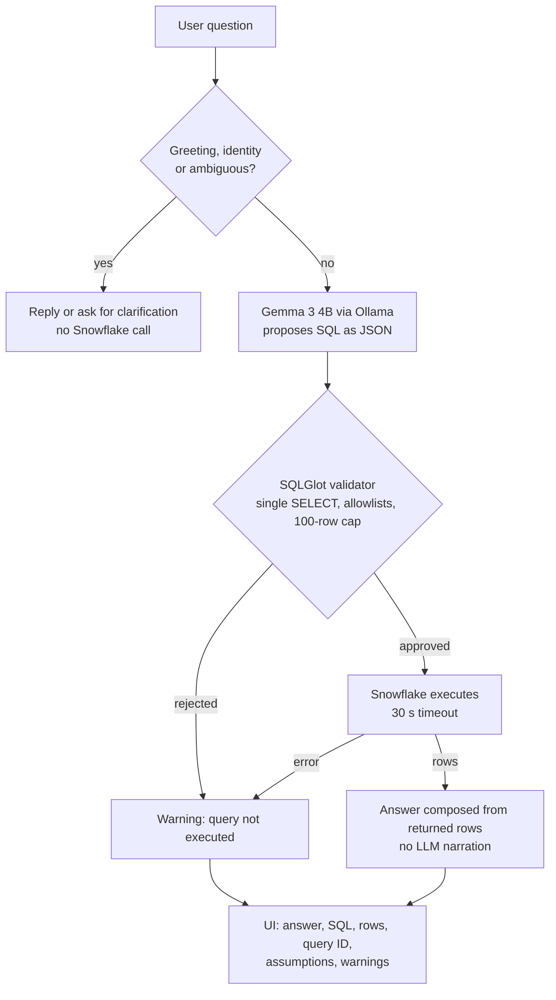

# Problem Statement

**The challenge.** Organizations hold large amounts of information in databases, spreadsheets, documents and other sources. Getting a useful answer often takes technical skills, specialised queries or hours of manual searching, so the people who understand the questions best are often the least able to reach the data.

**Your mission.** Create an AI-powered data experience that lets people ask questions in everyday language and get useful answers grounded in the available data, with enough explanation that users trust the response reflects the information actually examined.

**Keep in mind.** The goal is not fluent text. The system must meaningfully work with data (retrieve, query, analyse) and make its answers understandable and trustworthy. Think broadly about data types, industries and users: business intelligence, operations, research, education, finance and decision-making are all fair game. Unlike a chatbot that produces plausible text, a data agent computes answers from the real data, shows the query, rows or sources, flags gaps, and changes its answer when the data changes.

---

[README.md](https://github.com/user-attachments/files/33623777/README.md)<div align="center">

# 🐉 DataMind: Talk to Your Data

### Ask questions in plain English. Get answers computed from real Snowflake rows, with the SQL and query ID as proof.

**ZeroDay OSS Hacktoberfest 2026 · IIIT Dharwad · Track PS1**

[](LICENSE)


[Overview](#-overview) · [Architecture](#-architecture) · [Quick start](#-quick-start) · [Safety](#-safety-model) · [Testing](#-testing-and-evaluation) · [Limitations](#-limitations)

</div>

---

## 📌 Overview

Organizations hold large amounts of information in databases, but getting a useful answer usually takes SQL skills, specialised queries or hours of manual searching. The people who understand the questions best are often the least able to reach the data.

**DataMind** is a local natural-language interface to **Snowflake**:

1. You ask a question in everyday language.
2. **Gemma 3 4B**, running locally through **Ollama**, proposes a SQL query.
3. A **strict SQLGlot validator** approves or rejects it.
4. Only approved SQL is executed on **Snowflake**.
5. The answer is composed **directly from the returned rows**, with the executed SQL and the **Snowflake query ID** shown for verification.

> **Design principle: Gemma proposes, the validator decides, Snowflake computes.**
> The language model is never asked to narrate results, so it cannot invent numbers in the answer text.

### What every answer contains

| Output | Meaning |
|---|---|
| `answer` | Plain-language answer built from returned column names and row values |
| `sql` | The exact SQL that was executed |
| `columns`, `rows`, `row_count` | The complete result set |
| `query_id` | Snowflake query ID, verifiable in Snowsight Query History |
| `assumptions` | Interpretations the model made |
| `warnings` | Failures, rejections or anything the user should know |

### Example questions

```text
Show five customers with the highest account balances.
Count customers by market segment.
Who are the best customers?      →  asks a clarifying question before querying
```

---

## ✅ Requirement checklist

### Core requirements

| ID | Requirement | How DataMind meets it |
|---|---|---|
| M1 | Everyday-language questions | Natural-language input handled by Gemma 3 4B |
| M2 | Answers from real querying at question time | Each answer comes from a live Snowflake query |
| M3 | Grounded answers, no unsupported model claims | Answer text is composed from returned rows; the LLM does not narrate results |
| M4 | Plain-language explanation of how the answer was obtained | Answer, assumptions and warnings returned with every response |
| M5 | Inspectable evidence | Executed SQL, result rows and Snowflake query ID |
| M6 | Handling of ambiguity, empty results, unsupported requests | See [Behaviour on hard cases](#-behaviour-on-hard-cases) |
| M7 | Meaningful Snowflake and Gemma integration | See [Technology usage](#-how-the-required-technologies-are-used) |
| M8 | Working, reproducible, open source | This repository, MIT licensed, with setup and tests |

### Compliance gates

| Gate | Requirement | Status |
|---|---|---|
| G1 | Open-source repository with licence | ✅ MIT, see [`LICENSE`](LICENSE) |
| G2 | Reproducible without paid services or undisclosed credentials | ✅ Free Snowflake trial plus free local Ollama |
| G3 | Real system, not mock-ups | ✅ Live Ollama and Snowflake calls for every question |
| G4 | Datasets and licences disclosed, no data committed | ✅ See [Dataset](#-dataset-and-attribution) and [`DATASETS.md`](DATASETS.md) |
| G5 | No secrets in the repository | ✅ `.env` is git-ignored; only `.env.example` is committed |
| P1 | Snowflake used meaningfully | ✅ Every answer executes a query there |
| P2 | Gemma used meaningfully | ✅ Gemma generates the SQL |
| P3 | Answers derived from queries run at question time | ✅ |

---

## 🧩 How the required technologies are used

### Snowflake

| Aspect | Implementation |
|---|---|
| Role | Executes every approved query and is the single source of truth for answers |
| Data | `SNOWFLAKE_SAMPLE_DATA.TPCH_SF1.CUSTOMER`, accessed through the user's own account. Nothing is copied into this repository |
| Client | `src/datamind/snowflake_client.py`: credential check, connection, **30-second statement timeout**, result retrieval |
| Evidence | The **query ID** is returned with every successful answer |
| Failure handling | Execution failures return a warning and never claim a successful query |

### Gemma

| Aspect | Implementation |
|---|---|
| Model | **Gemma 3 4B** (`gemma3:4b`), configurable through `DATAMIND_MODEL` |
| Runtime | Local **Ollama**, configurable through `OLLAMA_URL` (default `http://localhost:11434/api/chat`) |
| Task | Translates a natural-language question into a SQL proposal returned as JSON, including its assumptions |
| Output handling | `src/datamind/llm.py` parses the JSON response; unusable output is reported as a failure |
| Not delegated to Gemma | SQL validation, query execution, row handling and answer composition |

**Separation of concerns:** model inference (Gemma) is kept apart from data storage and query processing (Snowflake). Nothing the model writes is trusted until the validator approves it.

---

## 🏗️ Architecture



### Project structure

| Path | Responsibility |
|---|---|
| `src/datamind/llm.py` | Ollama chat request and JSON response parsing |
| `src/datamind/validator.py` | Single-`SELECT` parsing; table, column, function and clause restrictions; 100-row cap |
| `src/datamind/snowflake_client.py` | Credential check, connection, 30 s statement timeout, result retrieval |
| `src/datamind/pipeline.py` | `ask(question)` orchestration: greetings and capabilities, ambiguity clarification, evidence-based answers, failure reporting |
| `src/datamind/api.py` | Local FastAPI adapter that delegates to `ask(question)` for the React console |
| `app/ui.py` | Streamlit interface showing answers, SQL, rows, query IDs, assumptions and warnings |
| `frontend/` | React, TypeScript and Vite Trust Console; session-only query history |
| `datamind_demo.py` | Interactive terminal interface |
| `eval/` | Deterministic evaluation runner and cases (`run_evaluation.py`, `cases.json`) |
| `snowflake_test.py` | Live Snowflake connection diagnostic |
| `DATASETS.md` | Dataset sources and attribution |

`ask(question)` returns `answer`, `sql`, `columns`, `rows`, `query_id`, `assumptions`, `warnings` and `row_count`. For multi-row results the answer text shows up to three rows, and the complete result remains in `rows`.

---

## 🛡️ Safety model

Generated SQL is treated as **untrusted input** and runs only if it passes every check.

| Layer | What it enforces |
|---|---|
| Single statement | Exactly one `SELECT` |
| Table allowlist | Only `SNOWFLAKE_SAMPLE_DATA.TPCH_SF1.CUSTOMER` |
| Column allowlist | Only `C_CUSTKEY`, `C_NAME`, `C_ACCTBAL`, `C_MKTSEGMENT` |
| Function and clause restrictions | Joins, subqueries, window functions, wildcard selection and arbitrary functions are rejected |
| Row cap | `LIMIT 100` is enforced |
| Statement timeout | 30 seconds on Snowflake |
| Pre-query routing | Greetings, identity questions and detected ambiguity return without contacting Snowflake |
| Secret hygiene | Credentials are never printed by the CLI; `.env` is git-ignored |

---

## 🧭 Behaviour on hard cases

| Situation | Behaviour | Calls Snowflake? |
|---|---|:---:|
| Greeting or "what can you do?" | Friendly capabilities reply | No |
| Ambiguous question (e.g. "best customers") | Asks a clarifying question before querying | No |
| Model returns unusable output | Warning reported; no query claimed | No |
| SQL fails validation (unknown column, join, `DROP`, …) | Rejected with a warning; **not executed** | No |
| Snowflake error or timeout | Warning reported; success is never claimed | Attempted |
| Valid query, zero rows | States that the query succeeded and returned no rows | Yes |
| Valid query, many rows | Answer shows up to three rows; full result stays in `rows` | Yes |

---

## 🚀 Quick start

### Prerequisites

| Item | Detail |
|---|---|
| Python | 3.10 or newer |
| Ollama | Installed and running ([ollama.com](https://ollama.com)) |
| Snowflake | A free 30-day trial needs only an email: [signup.snowflake.com](https://signup.snowflake.com). The account must be able to read `SNOWFLAKE_SAMPLE_DATA` |
| Memory and disk | Enough to run `gemma3:4b` locally (a download of a few GB) |

### Install

```bash
git clone https://github.com/ZERODAY-2026/Leviathan.git
cd Leviathan

python -m venv .venv
source .venv/bin/activate          # Windows: .venv\Scripts\activate
pip install -r requirements.txt

ollama pull gemma3:4b
ollama list                        # confirm the model is available

cp .env.example .env               # then fill in your values; never commit .env
```

### Configuration

| Variable | Required | Meaning |
|---|:---:|---|
| `SNOWFLAKE_ACCOUNT` | ✅ | Snowflake account identifier |
| `SNOWFLAKE_USER` | ✅ | Snowflake user |
| `SNOWFLAKE_PASSWORD` | ✅ | Snowflake password |
| `SNOWFLAKE_WAREHOUSE` | ✅ | Warehouse used to run queries |
| `DATAMIND_MODEL` | optional | Ollama model name, default `gemma3:4b` |
| `OLLAMA_URL` | optional | Default `http://localhost:11434/api/chat` |

The database and schema are fixed to `SNOWFLAKE_SAMPLE_DATA.TPCH_SF1`.

### Run

#### React Trust Console (primary web interface)

Start the local backend from the repository root after activating the Python environment and configuring `.env`:

```bash
uvicorn datamind.api:app --app-dir src --host 127.0.0.1 --port 8000
```

In another terminal, start the frontend:

```bash
cd frontend
npm install
npm run dev
```

Open <http://127.0.0.1:5173>. The optional `frontend/.env.local` can set `VITE_DATAMIND_API_URL` (default `http://127.0.0.1:8000`). The API health indicator reports only whether the API process responds; it does not probe Ollama or Snowflake. The API has no authentication and is intended for local use; keep it bound to loopback. Browser access allows only the Vite localhost origins by default. Additional explicit HTTP(S) origins can be set in `DATAMIND_CORS_ORIGINS`.

#### Streamlit fallback and terminal demo

```bash
streamlit run app/ui.py        # Streamlit fallback
python datamind_demo.py        # terminal demo
```

### Frontend checks

```bash
cd frontend
npm test
npm run build
```

Frontend tests mock the API. The production build checks TypeScript and bundles the UI; neither demonstrates a live Snowflake or Ollama connection.

---

## 🎬 Reproduce the demo

1. Start Ollama and confirm the model with `ollama list`.
2. Set the four Snowflake variables for an account that can read the sample `CUSTOMER` table.
3. Run `streamlit run app/ui.py`.
4. Ask **"Show five customers with the highest account balances."** Note the SQL, rows and query ID.
5. Ask **"Count customers by market segment."**
6. Ask **"Who are the best customers?"** to see clarification happen before any query runs.
7. Open Snowsight → *Monitoring → Query History*, find the displayed query ID, and confirm it matches the SQL shown in the app.

---

## 🧪 Testing and evaluation

### Unit tests

```bash
python -m pytest -q
```

Model and Snowflake calls are mocked, so unit tests need no credentials or network access.

### Deterministic behaviour evaluation

```bash
python eval/run_evaluation.py
```

The runner reports pass/fail case by case for the checked-in examples in `eval/cases.json`: returned rows, a `COUNT(*)` aggregate, a segment filter, ambiguity, rejected SQL, an empty result, model and database failures, and a greeting.

> **What this does and does not show.** These checks verify the system's expected *behaviour* on fixtures. They do **not** measure Gemma's SQL accuracy or live Snowflake correctness, and the fixture values are mocked: they must not be mistaken for real `CUSTOMER` data.

### Live connection check

```bash
python snowflake_test.py
```

A standalone diagnostic against your real Snowflake account. It is not part of the automated unit suite.

---

## 🔍 Evidence and traceability

- Every successful answer includes the **executed SQL** and the **Snowflake query ID**.
- Answer text is built from returned column names and row values, not from model narration.
- Failed generation, validation or execution returns warnings and **never claims a successful query**.
- To verify independently, copy a query ID into Snowsight → *Monitoring → Query History* and compare the query text and results.

---

## 📚 Dataset and attribution

| Dataset | Source | Terms | In this repo? |
|---|---|---|:---:|
| `SNOWFLAKE_SAMPLE_DATA.TPCH_SF1.CUSTOMER` | Snowflake sample data, accessed through the user's own account | No open licence stated by Snowflake; used in place | No |

TPC-H is benchmark data, not real customer records. See [`DATASETS.md`](DATASETS.md) and the official [Snowflake sample-data documentation](https://docs.snowflake.com/en/user-guide/sample-data).

**Gemma:** model weights are fetched by each user through Ollama under the licence of the variant used. They are not redistributed in this repository.

---

## 🔐 Security and secrets

- No keys, tokens or passwords are committed. `.env` is git-ignored and `.env.example` contains only blank placeholders.
- Credentials are never printed by the CLI.
- All generated SQL is validated before it can reach Snowflake.

---

## ⚠️ Limitations

We state these openly so you can judge the project on what it really does.

- **Narrow scope.** This milestone supports a conservative subset of `SELECT` against **one configured table and four columns**. Joins, subqueries, window functions, wildcard selection, arbitrary functions, and additional tables or columns are rejected.
- **Rule-based ambiguity detection.** It cannot cover every natural-language phrasing. Review the generated SQL and assumptions whenever intent matters.
- **No model-accuracy benchmark.** The deterministic evaluation measures expected behaviour on fixtures, not real Gemma accuracy or live Snowflake correctness.
- **Row cap is not a cost cap.** `LIMIT 100` bounds returned rows, not the work Snowflake performs. The 30-second statement timeout is the bound on query time.
- **Small local model.** Gemma 3 4B can occasionally write SQL that is valid but does not match the user's intent. The validator blocks unsafe SQL; it cannot guarantee the query answers the question asked.
- **Live demo requirements.** A working local Ollama install and valid Snowflake credentials are required.

---

## 💡 Main technical contribution

DataMind treats the language model as an **untrusted SQL proposer** and puts deterministic code on both sides of it: a strict SQLGlot validator before execution, and an answer composer after execution that uses only Snowflake-returned values. Answers are therefore grounded by construction, with the SQL and query ID available for independent verification, while inference stays fully local through Ollama.

---

## 🤝 Contributing

Issues and pull requests are welcome. Please run `python -m pytest -q` before submitting a change, and never commit credentials or dataset copies.

## 📄 Licence

Released under the **MIT License**. See [`LICENSE`](LICENSE).

---

<div align="center">

Built for **ZeroDay OSS Hacktoberfest 2026 · IIIT Dharwad**
Thanks to Snowflake, Google Gemma, Ollama and SQLGlot.

</div>
